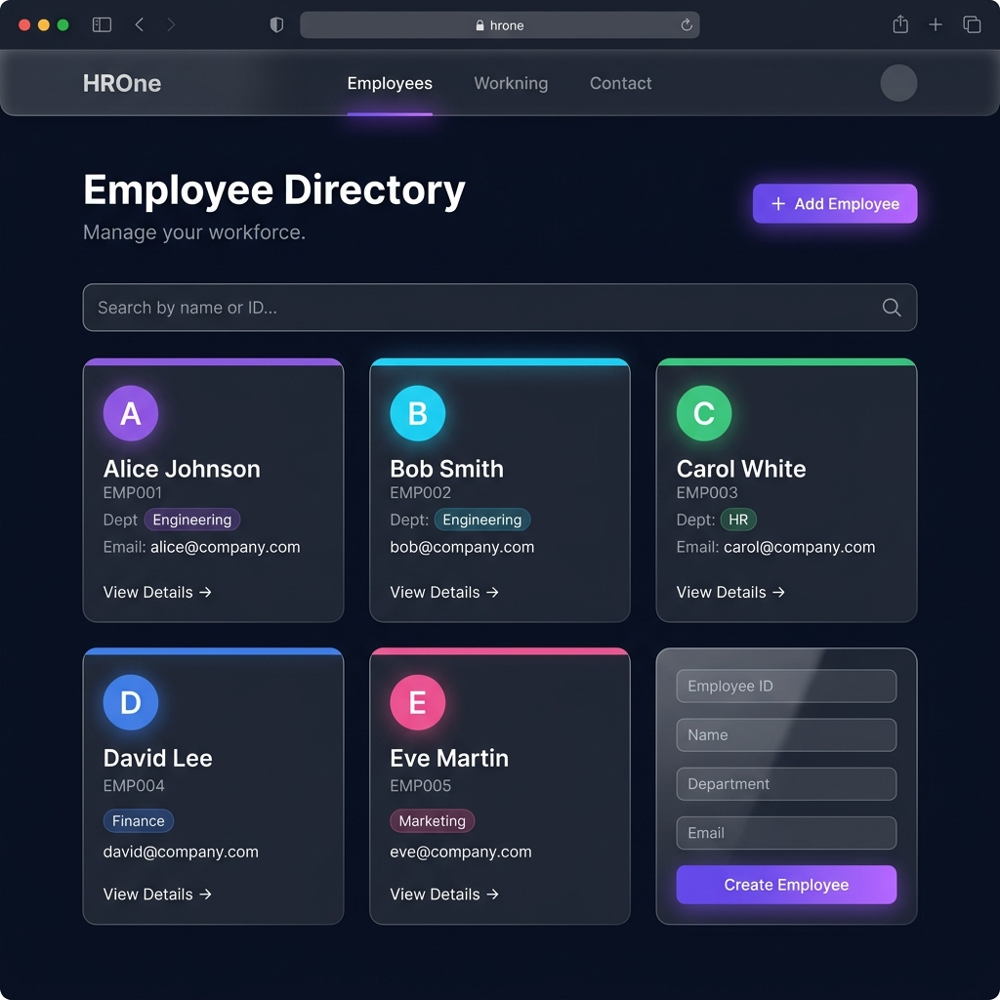
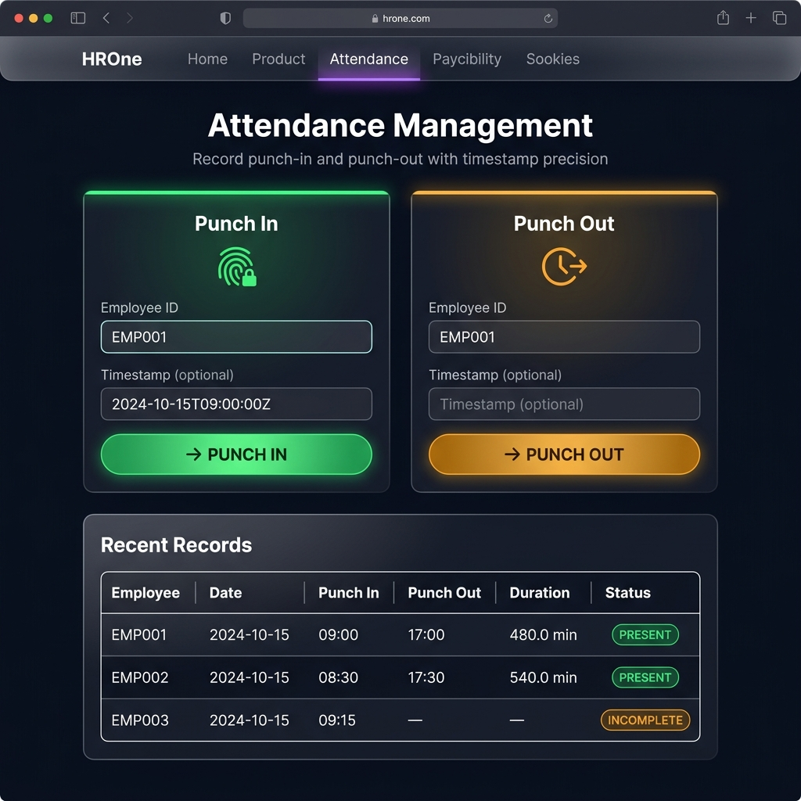
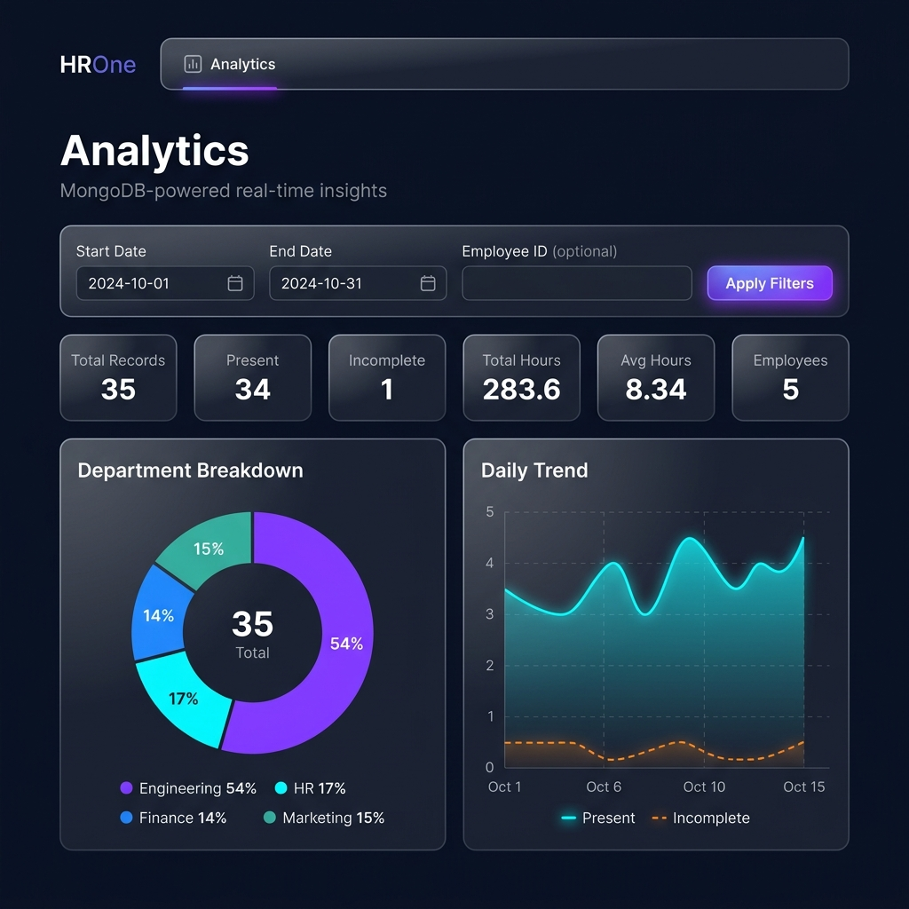

# HROne — Employee Attendance & Analytics API

> A production-grade REST API for employee attendance management built with **FastAPI** + **MongoDB**, with a dark-mode glassmorphism frontend dashboard.

---

## Table of Contents

- [Overview](#overview)
- [Features](#features)
- [Tech Stack](#tech-stack)
- [Project Structure](#project-structure)
- [Quick Start](#quick-start)
- [Configuration](#configuration)
- [API Reference](#api-reference)
- [Frontend Dashboard](#frontend-dashboard)
- [Running Tests](#running-tests)
- [Seeding Sample Data](#seeding-sample-data)
- [Database Indexes](#database-indexes)
- [HTTP Status Codes](#http-status-codes)

---

## Overview

HROne tracks daily employee attendance through **punch-in / punch-out** events. Every attendance record carries a full **audit trail** of manual corrections. Four MongoDB aggregation endpoints deliver real-time analytics — summary stats, per-employee breakdowns, department comparisons, and daily trends — all computed inside the database.

---

## Screenshots

### 🎛️ Dashboard


### 👥 Employee Directory


### 🕐 Attendance — Punch In / Out


### 📊 Analytics


---

## Features

- **Punch-in / Punch-out** — one open record per employee per day; duplicate attempts return `409`
- **Duration calculation** — stored as `duration_minutes` (float), computed at punch-out
- **Manual corrections** — append-only `corrections[]` array; original values always preserved
- **Full audit trail** — every correction stores `original`, `updated`, `reason`, `corrected_by`, `corrected_at`
- **4 analytics endpoints** — powered by MongoDB `$group`, `$lookup`, `$facet`, `$addToSet`, `$$REMOVE`
- **Date filtering** — all endpoints accept `start_date` / `end_date` (UTC ISO-8601)
- **Input validation** — Pydantic v2 with `EmailStr`, `min_length`, `max_length`, timestamp ordering
- **Interactive docs** — Swagger UI at `/docs`, ReDoc at `/redoc`
- **Dark-mode dashboard** — glassmorphism UI served at `/ui`
- **Health check** — `GET /health` pings MongoDB and reports live status

---

## Tech Stack

| Layer | Library / Tool | Version |
|-------|---------------|---------|
| API Framework | FastAPI | 0.115.5 |
| ASGI Server | Uvicorn | 0.32.1 |
| Database | MongoDB | 6+ |
| DB Driver | PyMongo | 4.10.1 |
| Validation | Pydantic v2 + email-validator | 2.10.3 / 2.3.0 |
| Testing | pytest + httpx | 8.3.4 / 0.28.1 |
| Frontend | Vanilla HTML / CSS / JS | — |
| Python | — | 3.11+ |

---

## Project Structure

```
HROne/
│
├── app/                            # Backend application
│   ├── main.py                     # FastAPI app, CORS, health endpoint, frontend mount
│   ├── config.py                   # Pydantic settings (reads .env)
│   ├── database.py                 # PyMongo connection + idempotent index creation
│   ├── models/
│   │   ├── employee.py             # EmployeeCreate, EmployeeResponse models
│   │   └── attendance.py           # PunchIn/Out, CorrectionRequest, AttendanceRecord
│   ├── routers/
│   │   ├── employees.py            # POST/GET /employees
│   │   ├── attendance.py           # punch-in, punch-out, history, correct
│   │   └── analytics.py           # summary, employee, department, trend/daily
│   └── services/
│       ├── attendance_service.py   # Business logic, atomic ops, duration calc
│       └── analytics_service.py    # All MongoDB aggregation pipelines
│
├── frontend/                       # Dark-mode dashboard (served at /ui)
│   ├── index.html                  # Single-page app entry point
│   ├── style.css                   # Glassmorphism dark-mode styles
│   └── app.js                      # Page routing + Chart.js canvas rendering
│
├── tests/                          # Automated test suite (uses hrone_test DB)
│   ├── conftest.py                 # Fixtures: session client, per-test DB wipe, helpers
│   ├── test_attendance.py          # Punch-in/out, state machine, duration tests
│   ├── test_corrections.py         # Correction validation, audit trail, cascade
│   ├── test_analytics.py           # All 4 analytics endpoints + empty dataset cases
│   └── test_analytics_regression.py # 15 MongoDB pipeline regression tests
│
├── evaluator.py                    # 169-test live API evaluator (8 categories)
├── seed_data.py                    # Seeds 5 employees + 35 Oct-2024 attendance records
├── live_api_test.py                # Quick manual smoke tests against running server
├── requirements.txt                # Python dependencies
├── pytest.ini                      # pytest configuration
├── start.bat                       # Windows one-click start script
├── .env.example                    # Environment variable template
├── .gitignore
└── DECISIONS.md                    # Architecture & design decision log
```

---

## Quick Start

### Prerequisites

- Python **3.11+**
- **MongoDB 6+** running at `localhost:27017`  
  *(or any URI — configure via `.env`)*

### 1 — Clone & install

```bash
git clone https://github.com/<your-username>/HROne.git
cd HROne

# Create virtual environment
python -m venv .venv

# Activate — Windows
.venv\Scripts\activate

# Activate — macOS / Linux
source .venv/bin/activate

pip install -r requirements.txt
```

### 2 — Configure environment

```bash
cp .env.example .env
# Edit .env if your MongoDB URI differs from the default
```

### 3 — Start the server

```bash
uvicorn app.main:app --reload --port 8000
```

**Or on Windows, double-click `start.bat`.**

| URL | Description |
|-----|-------------|
| `http://localhost:8000/ui` | Frontend dashboard |
| `http://localhost:8000/docs` | Swagger UI |
| `http://localhost:8000/redoc` | ReDoc |
| `http://localhost:8000/health` | Health check |

---

## Configuration

Edit `.env` (copied from `.env.example`):

```env
MONGODB_URI=mongodb://localhost:27017
MONGODB_DATABASE=hrone_attendance
```

| Variable | Default | Description |
|----------|---------|-------------|
| `MONGODB_URI` | `mongodb://localhost:27017` | MongoDB connection string (supports Atlas URIs) |
| `MONGODB_DATABASE` | `hrone_attendance` | Database name |

> The test suite automatically overrides `MONGODB_DATABASE` to `hrone_test` so production data is never touched.

---

## API Reference

### Employees

| Method | Endpoint | Success | Error | Description |
|--------|----------|---------|-------|-------------|
| `POST` | `/employees` | `201` | `409` duplicate, `422` validation | Create an employee |
| `GET` | `/employees` | `200` | — | List all employees |
| `GET` | `/employees/{employee_id}` | `200` | `404` | Get one employee |

**POST `/employees` — request body:**
```json
{
  "employee_id": "EMP001",
  "name": "Alice Smith",
  "department": "Engineering",
  "email": "alice@company.com"
}
```

---

### Attendance

| Method | Endpoint | Success | Error | Description |
|--------|----------|---------|-------|-------------|
| `POST` | `/attendance/punch-in` | `201` | `404` unknown emp, `409` already open | Record punch-in |
| `POST` | `/attendance/punch-out` | `200` | `409` no open record, `422` bad time | Record punch-out |
| `GET` | `/attendance/{employee_id}` | `200` | `404` | History (accepts `start_date`, `end_date`) |
| `PUT` | `/attendance/{id}/correct` | `200` | `404`, `422` | Manual correction — appends to audit |

**POST `/attendance/punch-in` — request body:**
```json
{
  "employee_id": "EMP001",
  "timestamp": "2024-10-07T08:30:00Z"
}
```

**PUT `/attendance/{id}/correct` — request body:**
```json
{
  "punch_in": "2024-10-07T08:00:00Z",
  "punch_out": "2024-10-07T17:00:00Z",
  "reason": "Badge log showed earlier entry",
  "corrected_by": "HR Manager"
}
```

---

### Analytics

All four endpoints accept optional query params: `start_date`, `end_date`, `employee_id`.

| Method | Endpoint | Description |
|--------|----------|-------------|
| `GET` | `/analytics/summary` | Overall totals — records, hours, avg, unique employees |
| `GET` | `/analytics/employee/{employee_id}` | Per-employee stats + daily breakdown |
| `GET` | `/analytics/department` | Stats grouped by department (via `$lookup`) |
| `GET` | `/analytics/trend/daily` | Daily record counts and average hours |

**`GET /analytics/summary` — example response:**
```json
{
  "total_records": 35,
  "present_records": 34,
  "incomplete_records": 1,
  "total_hours": 283.58,
  "avg_hours_per_day": 8.34,
  "unique_employees_count": 5
}
```

---

### System

| Method | Endpoint | Description |
|--------|----------|-------------|
| `GET` | `/health` | Returns `{"status":"ok","database":"connected"}` |
| `GET` | `/docs` | Swagger UI |
| `GET` | `/redoc` | ReDoc |
| `GET` | `/ui` | Frontend dashboard |

---

## Frontend Dashboard

Served at **`http://localhost:8000/ui`** — a single-page dark-mode glassmorphism app with:

- **Overview** — live summary cards + animated canvas charts
- **Employees** — directory with search
- **Attendance** — punch-in / punch-out form with live feedback
- **Analytics** — department and daily trend charts
- **Corrections** — audit trail browser

---

## Running Tests

The test suite uses `hrone_test` database and wipes collections before every test.

```bash
# Run all 49 unit tests
pytest -v

# Run one file
pytest tests/test_analytics.py -v

# Run regression tests only
pytest tests/test_analytics_regression.py -v
```

| Test File | Tests | Covers |
|-----------|-------|--------|
| `test_attendance.py` | 13 | Punch-in/out state machine, duration calc, history |
| `test_corrections.py` | 7 | All correction cases, audit trail, status cascade |
| `test_analytics.py` | 14 | All 4 analytics endpoints, empty datasets |
| `test_analytics_regression.py` | 15 | `$$REMOVE`, `$addToSet`, date boundaries, pipeline accuracy |
| **Total** | **49** | |

### Live API Evaluator

`evaluator.py` is a **169-test** strict evaluator against the running server. It auto-cleans its own test data before each run.

```bash
# Terminal 1 — start server
uvicorn app.main:app --reload --port 8000

# Terminal 2 — run evaluator
python evaluator.py
```

| Category | Tests |
|----------|-------|
| `[NORMAL]` — happy-path CRUD | 16 |
| `[SCHEMA]` — exact field names & types | 14 |
| `[DUPLICATE]` — idempotency guard | 4 |
| `[STATE]` — invalid transitions | 5 |
| `[BOUNDARY]` — timestamps, durations, overnight | 8 |
| `[CORRECTION]` — all 11 sub-cases | 14 |
| `[AUDIT]` — 3-correction stack, immutability | 17 |
| `[DATE]` — filter boundaries, sort order | 5 |
| `[EMPTY]` — zero-data responses | 14 |
| `[AGGREGATION]` — exact pipeline values | 66 |
| `[VALIDATION]` — 422 on bad inputs | 6 |
| **Total** | **169** |

---

## Seeding Sample Data

```bash
python seed_data.py
```

Creates **5 employees** and **35 attendance records** across October 2024:

| Employee | Department | Days | Notes |
|----------|-----------|------|-------|
| EMP001 | Engineering | 10 | All present |
| EMP002 | Engineering | 7 | 6 present, 1 incomplete |
| EMP003 | HR | 6 | All present |
| EMP004 | Finance | 5 | All present |
| EMP005 | Marketing | 5 | All present |

---

## Database Indexes

Created automatically on startup (idempotent):

| Collection | Index | Type | Purpose |
|-----------|-------|------|---------|
| `employees` | `employee_id` | Unique | Prevents duplicate employees |
| `attendance` | `(employee_id, date)` | Compound | Prevents double punch-in |
| `attendance` | `date` | Single | Date-range filter performance |
| `attendance` | `status` | Single | Status filter performance |

---

## HTTP Status Codes

| Code | Meaning |
|------|---------|
| `200` | Successful GET or PUT |
| `201` | Resource created (employee, punch-in) |
| `404` | Employee or attendance record not found |
| `409` | Conflict — duplicate employee, already punched in, punch-out with no open record |
| `422` | Validation error — bad timestamps, missing fields, invalid ObjectId, bad email |
| `500` | Unexpected server error (stack trace never exposed) |
| `503` | MongoDB unreachable (health check only) |

---

## Design Decisions

See [`DECISIONS.md`](DECISIONS.md) for the full architecture log covering:

- Why synchronous PyMongo over async Motor
- Why all aggregation stays inside MongoDB (`$$REMOVE` vs `0` in `$avg`)
- Atomic punch-in via `find_one_and_update`
- Append-only corrections array design
- Index strategy

---

## License

MIT
